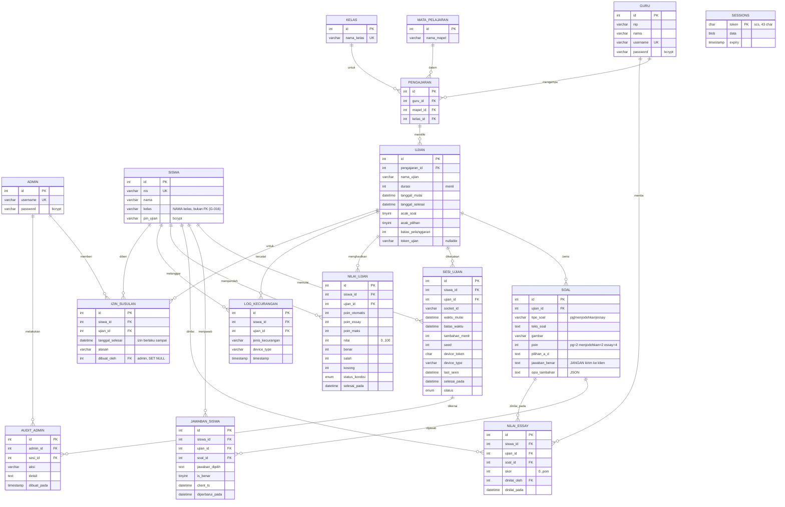

# ERD — CBT Sekolah (versi Go)

Dokumen terkait: [DESIGN](DESIGN.md), [PRD](PRD.md). **Sumber kebenaran skema: [migrations/](../migrations/)** (baseline `00001_baseline.sql`, G-007). ERD ini harus diperbarui bersama setiap migrasi baru.

Skema ini identik dengan skema akhir proyek Node (baseline + migrasi 001–003), ditambah tabel `sessions` untuk library session Go dan, sejak Fase 6, tabel `izin_susulan` (migrasi `00002`). Verifikasi baseline: dijalankan pada MySQL 8.4.10 → 15 tabel, 20 foreign key, `Down` bersih.

## 1. Diagram

## 2. Aturan integritas
- `UNIQUE (siswa_id, ujian_id)` pada `sesi_ujian` dan `nilai_ujian`.
- `UNIQUE (siswa_id, ujian_id, soal_id)` pada `jawaban_siswa` dan `nilai_essay`.
- Seluruh FK `ON DELETE CASCADE`, kecuali `nilai_essay.dinilai_oleh` dan `audit_admin.admin_id` → `SET NULL`.
- `sesi_ujian.status`: `sedang_ujian | selesai | keluar_paksa`. Online/offline **diturunkan** dari `last_seen` (online bila < 45 detik), bukan disimpan.
- `nilai_ujian.status_koreksi`: `menunggu_essay | selesai`.
- `soal.tipe_soal`: `pg | menjodohkan | essay`.
- `jawaban_siswa.jawaban_dipilih`: PG = huruf `A`–`D`; menjodohkan = JSON array pasangan; essay = tidak dipakai.
- `nilai_essay.skor` harus `0 ≤ skor ≤ soal.poin` (divalidasi aplikasi).
- `UNIQUE (siswa_id, ujian_id)` pada `izin_susulan` (migrasi `00002`, G-026). Izin hanya memperpanjang batas akhir bagi siswa itu: login/paket soal/realtime menerima siswa bila jadwal ujian terbuka ATAU izin masih berlaku (`sesi.KondisiJendelaSiswa`), dan `batas_waktu` dibatasi oleh yang lebih akhir antara `ujian.tanggal_selesai` dan izin (`sesi.SQLAkhirEfektif`). Jejak audit (`dibuat_oleh`, `alasan`, `created_at`) ada di tabel ini karena `audit_admin.sesi_id` wajib terisi sedangkan sesi belum ada saat izin diberikan.
- `soal.gambar` hanya berisi nama berkas `<32 hex>.<png|jpg|webp>` (G-023); berkas ada di `uploads/soal/`, bukan di database.
- Indeks tambahan khusus Go: `idx_sesi_status_batas (status, batas_waktu)` untuk job penutupan otomatis, `idx_sesi_ujian_status (ujian_id, status)` untuk snapshot monitor.

## 3. Waktu dan zona waktu
- Semua perhitungan sisa waktu memakai jam **database** (`NOW()`), konsisten dengan DESIGN §3.2.
- Server MySQL laptop sekolah berzona `SYSTEM` = WIB. `APP_TIMEZONE` (default `Asia/Jakarta`) harus **sama** dengan zona server MySQL; T0.4 menambahkan pemeriksaan saat startup.
- Kolom `DATETIME` tanpa zona; driver membaca dengan `parseTime=true` dan `loc` = `APP_TIMEZONE`.

## 4. Tabel `sessions` (scs)
Struktur mengikuti dokumentasi `github.com/alexedwards/scs/mysqlstore`: `token CHAR(43) PK`, `data BLOB`, `expiry TIMESTAMP(6)` + indeks `expiry`. **Berbeda** dari `express-mysql-session`, sehingga sesi login Node dan Go tidak saling kompatibel (memang tidak perlu: database terpisah). T0.6 wajib memverifikasi struktur ini ke dokumentasi scs terbaru.

## 5. Catatan data
- Data siswa asli tidak boleh masuk repo, dump, atau log. Gunakan data sintetis (NIS `T0001`…, PIN `1234` hanya di DB uji).
- `*.sql` diabaikan git kecuali `migrations/*.sql`.
- Migrasi baru: nama `NNNNN_deskripsi.sql`, format goose (`-- +goose Up/Down`), tanpa menghapus data, idempoten bila memungkinkan.
